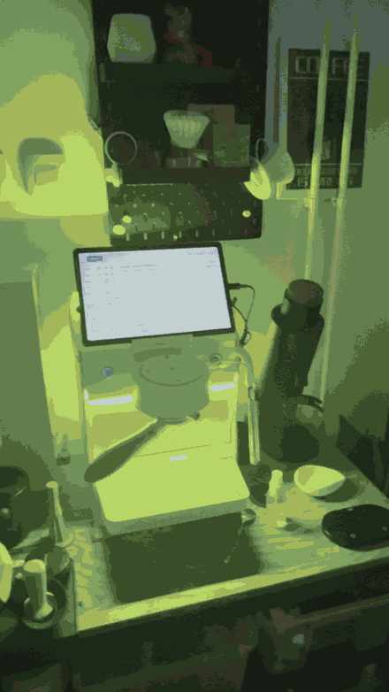
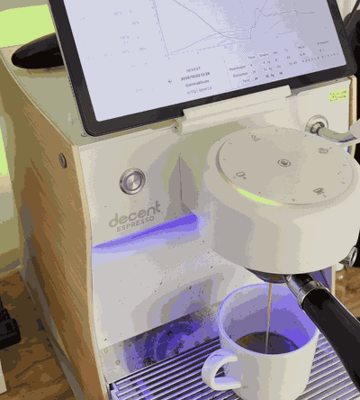

# Wiu Wiu RGB

<p align="center">
  
</p>

A [Decaid](https://github.com/decentespresso/decaid) plugin that turns a Bengle's
LED strips into a disco light, driven by what the machine is actually doing.

## In action

**`rainbow`** — the strips walk the hue wheel and the whole room follows.


**`playthrough`** — during a shot the back strip's green follows pressure and the
front strip's blue follows flow; when the shot ends it lets go and the machine's own
warm palette comes back (that is the amber at the end of the clip, not a preset).



Both clips are trimmed from phone footage and quantised to GIF — the encode is
reproducible with `./scripts/media.sh <rainbow|playthrough> <source.MOV>`.

Three presets, chosen in Decaid's plugin settings:

| Preset | What it does |
| --- | --- |
| `rainbow` (default) | cycles the whole strip through the hue wheel, all zones together |
| `breathing` | one colour (default warm white) fading 0 → full → 0, all zones together |
| `playthrough` | only while the machine is doing one of its four jobs — back strip shows **pressure** as a green ramp, front strip shows **flow** as a blue ramp, shade and brightness both move with the reading; `steam` goes amber. Outside `espresso`/`steam`/`flush`/`hotWater` it disengages and hands the strips back to their stored colours |

When the machine sleeps the plugin stops writing frames and hands the strips back
to the stored palette, so the machine's own sleep/wake colours win. The same happens
when a `playthrough` run ends: it only engages for `espresso`, `steam`, `flush` and
`hotWater`, and lets go as soon as the machine leaves them. When the machine wakes up
or the next job starts, the animation resumes on its own.

It talks to the machine the fast way: raw MMR writes to the two live LED
registers over Decaid's `/ws/v1/machine/raw` WebSocket, one frame per zone, no
REST round trip per frame.

* Behaviour contract: [`docs/spec.md`](docs/spec.md)
* Protocol reference (addresses, frame encoding, traps, install path):
  [`docs/protocol.md`](docs/protocol.md)

## Install

Decaid's REST API only installs plugins from GitHub, so a local build goes on the
tablet one of two ways:

**Release build (what the machine's tablet runs).** The APK is not debuggable, so
`adb` cannot write into its storage. Stage a zip and install it from the UI:

```sh
./scripts/pack.sh                       # -> dist/wiuwiu.reaplugin.zip
DECAID_HOST=<host>:8080 ./scripts/pack.sh --push   # ...and stage it on the tablet
# on the tablet: Settings -> Plugins -> (menu) Install plugin -> From zip
```

`DECAID_HOST` defaults to `localhost:8080`; set it whenever Decaid is not on the
machine you are running the scripts from.

Then enable it and pick a preset over REST:

```sh
curl -X POST http://<host>:8080/api/v1/plugins/wiuwiu.reaplugin/enable
curl -X POST http://<host>:8080/api/v1/plugins/wiuwiu.reaplugin/settings \
  -H 'content-type: application/json' -d '{"Preset":"rainbow"}'
./scripts/verify.sh
```

**Debuggable build (local dev).** `./scripts/deploy.sh [preset]` pushes the folder
with `adb push` + `run-as`, restarts Decaid so the startup plugin scan sees it,
enables it and selects the preset. It refuses to run unless the attached device's
IP matches the API's `localIp` — more than one Decaid on a network is normal, and
deploying to the wrong one looks like success and changes nothing.

Either way, `preset=rainbow` is the default the plugin ships with, so a fresh
install animates as soon as it loads.

## Status

`GET http://<host>:8080/api/v1/plugins/wiuwiu.reaplugin/status` reports the
active preset, machine state, transport state and frame counters — the cheapest
way to confirm it is actually animating.

## Develop

```sh
node --test test/
node scripts/live-sim.mjs      # run the plugin against a live instance, no Decaid needed
```

No dependencies, no build step: `plugin.js` is the artifact Decaid loads, and the
tests evaluate it in a `vm` context with a fake host.

`scripts/live-sim.mjs` is the end-to-end check: it shims the host API onto Node's
`WebSocket`/`fetch`, runs the real `plugin.js` against a live instance for a few
seconds (the strips actually animate), prints the status counters, and calls
`onUnload` so the machine gets its stored palette back. Point it at your instance
with `DECAID_HOST=decaid.local:8080`.

## Licence

GPL-3.0-or-later. See [LICENSE](LICENSE).
